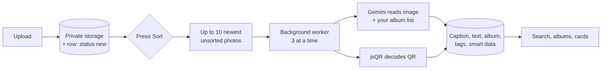

<div align="center">


# Snapzy

**An AI-powered screenshot sorter and picture organizer.**
Drop in screenshots and photos, press *Sort*, and AI reads every image, writes a caption, files it in the right album and pulls out the details you care about: receipts, payments, WiFi passwords, QR codes and more.


</div>

---

## Table of contents

- [Why Snapzy](#why-snapzy)
- [Features](#features)
- [How it works](#how-it-works)
- [Tech stack](#tech-stack)
- [Getting started](#getting-started)
- [Environment variables](#environment-variables)
- [Database setup](#database-setup)
- [Scripts](#scripts)
- [Project structure](#project-structure)
- [Security and privacy](#security-and-privacy)
- [Known limitations](#known-limitations)
- [Roadmap](#roadmap)
- [Deployment](#deployment)
- [Author](#author)

## Why Snapzy

Screenshots pile up in a long, unsorted timeline, and the text inside them can't be searched. Snapzy turns that pile into an organized gallery:

- **Sorted for you.** AI files each picture into albums you define.
- **Searchable.** Find a photo by any word that appears *inside* it.
- **Useful.** Amounts, reference numbers, WiFi passwords and QR codes are extracted into cards you can copy.
- **Safe.** Detected passwords are masked by default.

## Features

| Area | What you get |
| --- | --- |
| **Accounts** | Email and password sign up and login, protected dashboard, password change, profile photo, password-confirmed account deletion. |
| **Upload** | Drag and drop, file picker, or paste (Ctrl+V). PNG, JPG, WEBP and GIF up to 10 MB, with progress for each file. |
| **Manual AI sorting** | Nothing is analyzed until you press **Sort photos**. Up to **10** unsorted photos per press, three at a time, with a **Cancel** button. |
| **Live estimate** | A countdown that switches to the run's real pace once photos finish, and learns your actual speed over time. |
| **AI reading** | OCR text, a one-sentence caption, an album, 2 to 3 tags and structured details for every photo. |
| **Smart cards** | WiFi, Payment, Receipt, Flight, Login, QR/Barcode and Contact (emails, phones, socials, names, links, addresses). |
| **QR decoding** | QR codes are decoded from the pixels for exact payloads, including WiFi QR codes. |
| **Password masking** | Passwords and PINs are hidden in captions, OCR text and cards. An eye button reveals them. |
| **Albums** | 13 built-in albums plus your own, with name, color and a hint for the AI. Albums look like stacks of prints. Move a photo with **Move to...** |
| **Search** | Ranked full-text search over captions, OCR text, tags and file names, with search-as-you-type. |
| **Photo detail** | Shared-element animation, copy-text button, related photos, arrow-key navigation. |
| **Download** | Download a single photo, or a whole album as a ZIP. |
| **Settings** | Light, dark or system theme. English or Tagalog. Clear all photos or reset albums. Terms, privacy and about pages. |
| **Responsive** | Phones, tablets and desktop. Fixed header and bottom navigation on small screens. Installable to the home screen (web manifest, app icon). |

## How it works



1. **Upload** stores the file in a private Supabase Storage bucket and a row with status `new`.
2. **Sort** marks up to 10 photos `pending` and returns immediately. A worker started with `after()` claims each row, downloads the image and sends it to Gemini together with your album names and descriptions.
3. The reply is validated against a **Zod schema**, so the album must be one of yours and every extracted field is typed.
4. If a model is overloaded or out of quota, the next model is tried: `gemini-3.8-flash`, then `gemini-3.5-flash`, then `gemini-3.5-flash-lite`.
5. **Cancel** returns queued and in-progress photos to `new`. Workers save results only if the row is still `processing`, so a cancelled photo never gets a late result.

## Tech stack

| Layer | Technology |
| --- | --- |
| Framework | Next.js 16 (App Router, Cache Components, React Compiler) |
| UI | React 19, Tailwind CSS v4, Motion |
| Language | TypeScript (strict) |
| Backend | Supabase: PostgreSQL with row-level security, Auth, Storage |
| AI | Vercel AI SDK with `@ai-sdk/google` (Gemini Flash family), Zod |
| Image tools | `sharp`, `jsqr` |
| Export | `jszip` |
| Quality | ESLint, TypeScript compiler |

## Getting started

### Prerequisites

- Node.js 20 or later
- A free [Supabase](https://supabase.com) project
- A free Gemini API key from [Google AI Studio](https://aistudio.google.com/apikey)

### Install and run

```bash
git clone https://github.com/BryxCinco/snapzy.git
cd snapzy
npm install

# create your local env file, then fill in the values (see below)
cp .env.example .env.local

npm run dev
```

Open <http://localhost:3000>.

> **Next.js 16 note:** `middleware` is now `proxy.ts`, and Cache Components change how session reads are done. See `AGENTS.md` and `node_modules/next/dist/docs/` before changing routing or data-loading code.

## Environment variables

Copy `.env.example` to `.env.local`. **Never commit `.env.local`**; it is already git-ignored.

| Variable | Required | Where to get it | Exposed to the browser |
| --- | --- | --- | --- |
| `NEXT_PUBLIC_SUPABASE_URL` | Yes | Supabase, Project Settings, API. Must start with `https://`. | Yes |
| `NEXT_PUBLIC_SUPABASE_ANON_KEY` | Yes | Supabase anon or publishable key (not the project ID). | Yes, protected by row-level security |
| `GOOGLE_GENERATIVE_AI_API_KEY` | Yes | Google AI Studio. | **No**, server only |
| `GEMINI_MODEL` | No | Overrides the first model tried (default `gemini-3.8-flash`). | No |

`NEXT_PUBLIC_*` values are baked in at build time. After changing them, restart `npm run dev` or rebuild.

Do **not** use the Supabase `service_role` key anywhere in this app. It isn't needed.

## Database setup

In the Supabase dashboard, open **SQL Editor, New query** and run these files **in order**:

| # | File | Purpose |
| --- | --- | --- |
| 1 | `supabase/schema.sql` | Base tables, indexes, RLS policies, private `screenshots` bucket |
| 2 | `supabase/migrations/002_upload_metadata.sql` | File name, size and type columns; bucket limits |
| 3 | `supabase/migrations/003_ai_processing.sql` | Processing status, error and start time |
| 4 | `supabase/migrations/004_search.sql` | Ranked search function `search_screenshots(q)` |
| 5 | `supabase/migrations/005_custom_categories.sql` | Per-user albums table |
| 6 | `supabase/migrations/006_categories_grants.sql` | API grants for the albums table |
| 7 | `supabase/migrations/007_smart_metadata.sql` | `metadata` jsonb column for smart cards |
| 8 | `supabase/migrations/008_manual_sort.sql` | Allows status `new` (manual sorting) |
| 9 | `supabase/migrations/009_delete_account.sql` | `delete_my_account()` function |

All files are safe to re-run. If a step is missing, the app shows a message pointing to the right file (for example, account deletion explains that 009 hasn't been run).

Optional, in **Authentication, URL Configuration**: set the site URL and add `http://localhost:3000/auth/callback` so email confirmation links return to the app.

## Scripts

| Command | What it does |
| --- | --- |
| `npm run dev` | Start the dev server |
| `npm run build` | Production build |
| `npm start` | Serve the production build |
| `npm run lint` | Run ESLint |
| `npx tsc --noEmit` | Type-check |

## Project structure

```text
snapzy/
├── public/
│   ├── brand/              App icon and logo (SVG + PNG)
│   └── landing/            Sample photos used on the landing page
├── supabase/
│   ├── schema.sql          Base schema, RLS, storage bucket
│   └── migrations/         002 to 009, run in order
└── src/
    ├── proxy.ts            Session refresh and route guard (Next 16 "middleware")
    ├── app/
    │   ├── page.tsx        Landing page
    │   ├── (auth)/         Login and signup
    │   ├── auth/callback/  Email confirmation handler
    │   ├── dashboard/
    │   │   ├── actions.ts          Upload, sort, cancel, search, delete
    │   │   ├── process-screenshot.ts  Per-photo AI processing
    │   │   ├── category-actions.ts    Album create, edit, delete, move
    │   │   ├── download/route.ts      Album ZIP download
    │   │   ├── gallery-view.tsx       Albums, search results, selection
    │   │   ├── gallery-hero.tsx       Greeting, upload and Sort tile
    │   │   └── settings/              Account, theme, language, danger zone
    │   ├── about/ privacy/ terms/     Info pages
    │   ├── manifest.ts, icon.svg, apple-icon.png, favicon.ico
    │   └── globals.css     Design tokens and dark mode
    ├── components/         Cards, detail modal, smart cards, toast, logo
    └── lib/
        ├── ai/analyze-screenshot.ts   Prompt, schema, model fallback
        ├── metadata.ts                Parsing and password masking
        ├── qr-decode.ts               QR decoding and WiFi QR parsing
        ├── categories*.ts             Built-in albums, constants
        ├── i18n.ts                    English and Tagalog text
        └── supabase/                  Browser, server and proxy clients
```

## Security and privacy

- **Row-level security** on every table and on the storage bucket. A user can only read or change their own rows and files.
- **Private bucket.** Images are shown through signed URLs that expire after one hour.
- **Server-only AI key.** The Gemini key has no `NEXT_PUBLIC_` prefix and is read only on the server.
- **No service-role key** in the app. Account deletion uses a `SECURITY DEFINER` function that can only delete the caller's own account, after the password is re-checked.
- **Secrets are masked.** The AI is told never to put passwords in captions or tags, and detected secrets are hidden until revealed.
- **Input limits.** File type and size are checked in the browser, the server action and the bucket. Sorting is capped at 10 photos per press.
- Images are sent to Google for analysis. This is stated in the in-app Privacy Policy.

## Known limitations

- The free Gemini tier has a small daily request quota. When it runs out, photos fail and can be retried later.
- AI can misread text. Check important values (amounts, reference numbers) against the image.
- HEIC (iPhone default) isn't accepted yet. Convert to JPG first.
- Background sorting runs after the response. On hosts with short function time limits a long run could be cut off; the 10-photo batch reduces this.
- The learned sort speed is stored per device (browser storage).
- Large libraries load full-size images; thumbnails and pagination are planned.

## Roadmap

- [ ] Thumbnails and infinite scroll
- [ ] Clear message when the daily AI quota is reached
- [ ] Durable background job queue
- [ ] Forgot-password flow
- [ ] HEIC upload support
- [ ] Duplicate detection
- [ ] Reverse image search (find where a picture came from)
- [ ] Share-to-Snapzy from the phone gallery
- [ ] Keep manual album moves out of Re-analyze
- [ ] Automated tests

## Deployment

Snapzy runs on any host that supports Next.js 16 (for example Vercel).

1. Push the repository to GitHub and import it into your host.
2. Add the environment variables from [Environment variables](#environment-variables) in the host's settings.
3. In Supabase, set **Site URL** and **Redirect URLs** to your deployed domain (`https://your-domain/auth/callback`).
4. Check the host's function time limit and request body size. Uploads allow up to 11 MB (`next.config.ts`).

## Author

**Brian Paul Francisco**, [@BryxCinco](https://github.com/BryxCinco)

*Your screenshots, curated like art.* ✿
